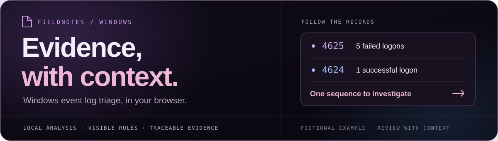

<div align="center">



# Windows Security Event Log Triage Tool

**Turn Windows event exports into evidence you can investigate.**

[**Open live demo ↗**](https://namitesh07.github.io/windows-security-event-log-triage-tool/) · [Documentation](docs/inputs.md) · [Releases](https://github.com/Namitesh07/windows-security-event-log-triage-tool/releases)

[](#privacy-by-design)
[](docs/rules.md)
[](docs/collections.md)
[](docs/development.md)

</div>

---

A browser-based investigation workspace for students and early-career analysts. Bring together Windows event exports, follow suspicious sequences, and understand **why each finding deserves attention**.

<a id="privacy-by-design"></a>

> **Your logs stay in your browser.** No event uploads, analytics, accounts, or automatic storage. You choose when to save a case or download a report.

## What you can do

| Feature | Inside the workspace |
| --- | --- |
| **Investigate activity** | Review authentication patterns, account/group changes, process and PowerShell cues, services, tasks, and audit/firewall changes. |
| **Combine evidence** | Open up to **20 files** together. Track each source and its SHA-256 fingerprint, and inspect confirmed duplicates without discarding original records. |
| **Understand the result** | Explore **23 visible rules**, score contributions, supporting records, benign explanations, and per-rule data gaps, and ATT&CK learning references. |
| **Continue the case** | Add analyst notes, filter evidence, save/reopen investigations, and export JSON, CSV with spreadsheet formula protection, or printable investigation reports. |

**Accepted formats:** CSV · Windows Event XML · JSON · JSON Lines/NDJSON. Raw EVTX needs [local conversion](docs/inputs.md#convert-evtx-locally-on-windows).

<a id="how-to-use-it"></a>

## Start in three steps

1. **Load evidence** — open the [demo](https://namitesh07.github.io/windows-security-event-log-triage-tool/) and choose a [fictional sample](samples/README.md) or your authorised event exports.
2. **Follow a finding** — select **Analyse events**, inspect its supporting records, and check coverage gaps.
3. **Keep your work** — add notes, then select **Save entire case** or download a report.

<details>
<summary><strong>Prefer to run it locally?</strong></summary>

The app needs no build or package installation. With Git and Python 3 available:

```bash
git clone https://github.com/Namitesh07/windows-security-event-log-triage-tool.git
cd windows-security-event-log-triage-tool
python3 -m http.server 8000 --bind 127.0.0.1
```

Open **http://127.0.0.1:8000**. Event collections support **25 MB combined / 100,000 source records**. Opening `index.html` directly uses a **2 MB combined** fallback. See [input limits](docs/inputs.md) and [developer setup](docs/development.md).

</details>

<a id="know-the-limits"></a>

## Read the findings with context

This is an **educational triage tool**. Findings prioritise visible activity for review; they do not prove compromise or authorisation. Results depend on the exported fields, timestamps, and available audit coverage. Validate important findings with surrounding evidence.

## Explore further

| Investigate | Understand | Build |
| --- | --- | --- |
| [Inputs & EVTX conversion](docs/inputs.md) | [Detections](docs/detections.md) · [ATT&CK](docs/attack.md) | [Development](docs/development.md) |
| [Collections & fingerprints](docs/collections.md) | [Rule coverage & data gaps](docs/coverage.md) | [Testing & CI](docs/testing.md) |
| [Saved cases](docs/cases.md) · [Reports & printing](docs/printing.md) | [Rules & tuning profiles](docs/rules.md) | [Changelog](CHANGELOG.md) |

---

<div align="center">

Created by **[Namitesh Pandey](https://github.com/Namitesh07)** · Cybersecurity learning & portfolio project

**Investigate the evidence. Keep the human in the loop.**

<sub>Shared for portfolio and educational viewing. No licence is granted at this time.</sub>

</div>
